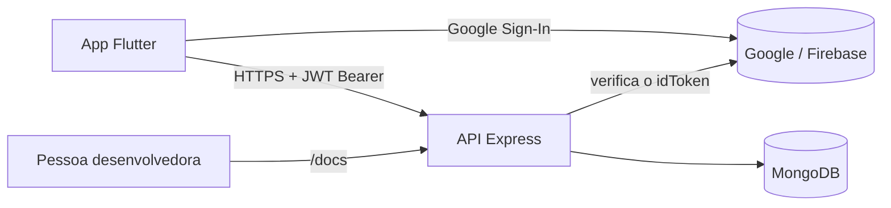

# Documentação técnica da API

API do app [Planejamento Financeiro](https://github.com/Janilso/planejamento_financeiro): login com a conta Google e lançamentos de ganhos e gastos, à vista ou parcelados, agrupados por mês.

- **Contrato das rotas:** Swagger em `http://localhost:8080/docs` com a API rodando (o link aparece no terminal ao subir), ou o JSON em `/docs/openapi.json`. O spec fica em [`src/docs/openapi.ts`](../src/docs/openapi.ts).
- **Como rodar:** [README do projeto](../README.md).

## Índice

| Documento | Assunto |
|---|---|
| [Arquitetura](arquitetura.md) | Camadas, pastas, ordem dos middlewares e o caminho de uma requisição |
| [Autenticação](autenticacao.md) | Login com Google, tokens, renovação, logout e proteções |
| [Lançamentos](lancamentos.md) | Regras de valores, parcelas, meses, edição e exclusão |
| [Dados](dados.md) | Coleções do MongoDB, índices e a migração |
| [Erros](erros.md) | Formato de erro, tipos, mensagens e status |
| [Operação](operacao.md) | Variáveis de ambiente, segurança, logs, Swagger e scripts |
| [Testes](testes.md) | Como a suíte funciona, padrões e CI |
| [Contribuindo](contribuindo.md) | Roteiro para uma rota nova e convenções |

## Visão geral

Stack: Node ≥ 22, TypeScript, Express 5, Mongoose 9, zod 4, `helmet`, `express-rate-limit`, `pino-http`, `swagger-ui-express`. Testes com Vitest, supertest e MongoDB em memória.
