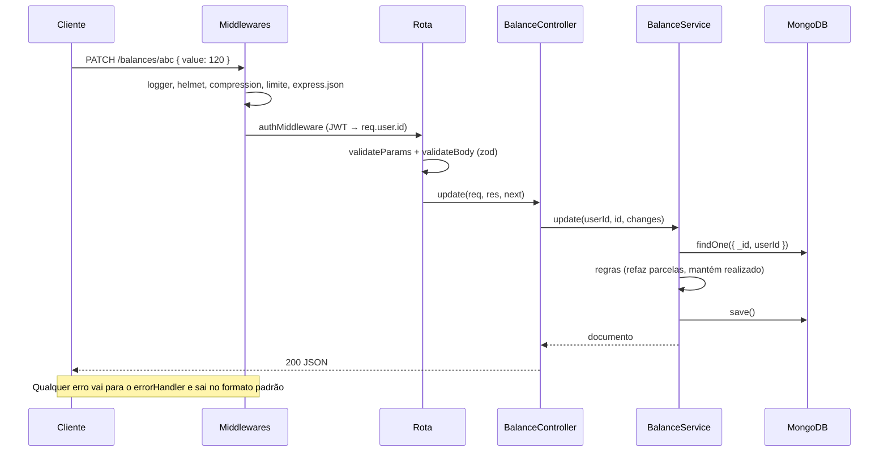

# Arquitetura

## Camadas

Cada requisição passa pelas mesmas camadas, cada uma com uma responsabilidade:

| Camada | Pasta | Faz | Não faz |
|---|---|---|---|
| Rota | `src/routes/` | Liga método e caminho aos middlewares e ao controller | Regra de negócio |
| Middlewares | `src/middlewares/` | Autenticação, validação do corpo e dos parâmetros (zod), limite de requisições, erros | Acesso ao banco |
| Controller | `src/controllers/` | Lê `req`, chama o service, escolhe o status da resposta | Regra de negócio |
| Service | `src/services/` | Regras (parcelas, edição, agrupamento por mês, tokens) | Conhecer `req`/`res` |
| Model | `src/models/` | Schemas do Mongoose e índices | — |

Os schemas zod (`src/schemas/`) validam a entrada **e** geram os corpos de requisição do Swagger (`src/docs/zodToSchema.ts`): a regra fica num lugar só.

## Pastas

```
src/
├── server.ts        conecta no MongoDB, sobe o servidor e mostra o link do Swagger
├── app.ts           monta o Express: middlewares, rotas, docs, 404 e erros
├── config/          ambiente (validado com zod), conexão, JWT, logger, mapa de erros do Mongo
├── routes/          auth.route.ts e balance.route.ts
├── middlewares/     auth, validateBody, validateParams, rateLimit, notFound, errorHandler
├── controllers/     AuthController e BalanceController
├── services/        AuthService e BalanceService (as regras)
├── models/          UserModel e BalanceModel
├── schemas/         AuthSchema e BalanceSchema (zod)
├── docs/            spec OpenAPI, conversor zod → JSON Schema e a rota /docs
├── migrations/      migração de índices de balances (CLI com dry-run)
├── scripts/         token:dev
└── utils/           mensagens de erro, fuso e chave do mês
```

`server.ts` fica separado de `app.ts` para os testes usarem o app sem abrir porta nem conectar no banco real.

## Ordem dos middlewares (`src/app.ts`)

A ordem importa: cada etapa só vê o que passou pelas anteriores.

1. `z.config(z.locales.pt())`: mensagens do zod em português (global).
2. `trust proxy`, se `TRUST_PROXY > 0`.
3. Logger (`pino-http`): um log por requisição, com o `Authorization` oculto.
4. `helmet()`: cabeçalhos de segurança.
5. `compression()`: comprime a resposta com gzip quando o cliente manda `Accept-Encoding: gzip` e ela passa de 1 KB. O `GET /balances` devolve o histórico inteiro (~90 KB por ano sem compressão, ~7 KB com gzip, nos dados de teste). Uma resposta comprimida sai sem `Content-Length` (`Transfer-Encoding: chunked`).
6. Limite de requisições: um para `/auth` e outro para o resto.
7. `express.json()`: lê o corpo. JSON malformado vira erro 400 no `errorHandler`.
8. Rotas de autenticação e de lançamentos.
9. Documentação (`/docs` e `/docs/openapi.json`).
10. `notFoundHandler`: qualquer outro caminho responde 404 em JSON.
11. `errorHandler`: converte erros no formato padrão (veja [Erros](erros.md)).

## Caminho de uma requisição

Exemplo: `PATCH /balances/:id`.



Os controllers usam `asyncHandler` (`src/middlewares/errorHandler.middleware.ts`) para que erros de funções `async` cheguem ao `errorHandler`.
