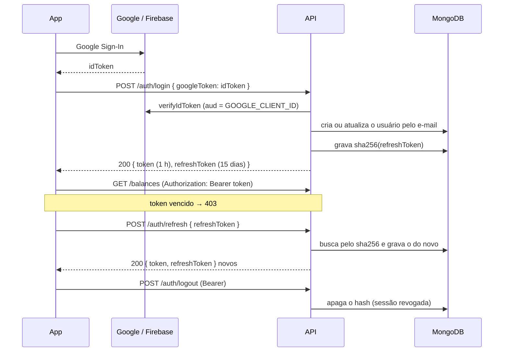

# Autenticação

A API não tem senha própria: quem prova a identidade é o Google. Depois do login, a API emite os próprios tokens (JWT).

## Fluxo completo

## Login (`AuthService.login`)

- O `idToken` é verificado com `google-auth-library`, com o `GOOGLE_CLIENT_ID` como audiência. Precisa ser o *Web client* do projeto Firebase, que é a audiência do `idToken` do app.
- O login é recusado (401 `AuthError`) se o token for inválido, se faltar e-mail ou nome, ou se `email_verified` for `false`.
- O usuário é criado ou atualizado pelo e-mail (`findOneAndUpdate` com `upsert`).

## Tokens (`src/config/token.config.ts`)

| Token | Segredo | Validade | Payload |
|---|---|---|---|
| Acesso | `JWT_SECRET_KEY` | 1 hora | `{ id }` (id do usuário) |
| Refresh | `JWT_REFRESH_SECRET_KEY` | 15 dias | `{ id }` |

- **Envio:** `Authorization: Bearer <token>`. O token cru, sem `Bearer`, também é aceito, por compatibilidade (`src/middlewares/auth.middleware.ts`).
- **Sem header → 401; token inválido ou vencido → 403.** O app trata os dois chamando o refresh.

## Refresh e revogação (`AuthService.refresh` e `logout`)

- O banco guarda **só o hash sha256** do refresh token atual (`users.refreshTokenHash`), nunca o token. Um vazamento do banco não entrega sessões válidas.
- **Rotação:** cada refresh devolve um par novo, e o refresh antigo deixa de valer (o hash é trocado).
- **Refresh que está no banco mas falha na verificação** (assinatura, validade ou dono errados) **revoga** a sessão: o hash é apagado. Um refresh que não está no banco só recebe 401.
- **Logout** apaga o hash. Depois dele, o refresh antigo responde 401.
- Toda gravação passa por `saveRefreshToken`, que também remove o campo `refreshToken` em texto puro de versões antigas (`$unset` com `strict: false`).

## Proteções

- **Limite de requisições:** `/auth` tem um limite próprio por IP (`RATE_LIMIT_AUTH_MAX`, padrão 20 a cada 15 minutos). Passou disso, 429. Veja [Operação](operacao.md).
- **Logs:** o header `Authorization` aparece como `[Redacted]`.

## Token para desenvolvimento

`npm run token:dev -- <userId>` imprime um token de acesso de 1 hora, assinado com o `JWT_SECRET_KEY` do ambiente, para usar no *Authorize* do Swagger. O script se recusa a rodar com `NODE_ENV=production` (`src/scripts/devToken.ts`).
